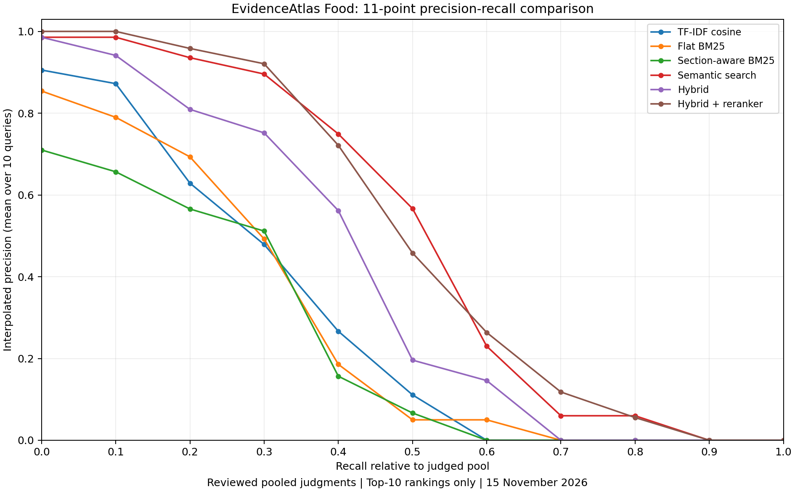

# EvidenceAtlas Food: 10-query evaluation

Date: 15 November 2026. Evaluation methods adapted from the supplied **08eval (1).pdf**, Lecture 8: Evaluation & Result Summaries.

**All 310 pooled question–paper pairs were reviewed for relevance.**

## Setup

- Corpus: 3,493 searchable papers; 102,752 source passages.
- Corpus fingerprint: `a524efa0f09a93ac6aba5c4d4f7608d6b01e9e410b6b98fad2453e2d72998216`.
- Source commit: `28aec6e96aa82955d0ff4c33ad8c5ca7087e0d2a`; implementation hashes are recorded in protocol.json.
- Six existing retrieval methods x 10 questions x 10 results = 600 ranked positions; 310 distinct query-paper pairs, all reviewed.
- Questions and information needs were fixed before viewing these rankings. Five easy and five medium questions; difficulty is a qualitative label, not measured.
- Query expansion enabled for every method, no metadata filters, recency preference disabled. No ranking changes, ingestion, model tuning or post-result query rewrites.
- Relevance grades: 0 = irrelevant, 1 = related/background, 2 = directly useful but partial/applicability-limited, 3 = directly applicable. Binary relevance is grade >= 2.
- Review screened titles and query-focused abstract excerpts, then inspected complete abstracts and retrieved passages for ambiguous cases. This was not an exhaustive full-paper review. Full stored abstracts and retrieved passages are retained for audit.
- Reviews and null findings can be relevant. Background citations in primary studies are not treated as that study's own results; review articles can synthesize cited evidence. Human-health questions require human-applicable evidence; laboratory cooking experiments qualify for the cooking question.
- Papers were reviewed in paper-ID order with method names and ranks hidden.
- Rankings were collected in one read-only SQLite transaction; the corpus fingerprint and active index pointer were checked unchanged. Saved source text and rankings are retained for audit.

## The 10 questions

| ID | Difficulty | Question |
|---|---|---|
| Q01 | Easy | Does drinking coffee affect sleep? |
| Q02 | Easy | Does reducing salt intake lower blood pressure? |
| Q03 | Easy | Does eating more fiber help with constipation? |
| Q04 | Easy | Does drinking milk help keep bones strong? |
| Q05 | Easy | Does boiling vegetables reduce their vitamin C content? |
| Q06 | Medium | Does eating oats lower LDL cholesterol? |
| Q07 | Medium | Does eating nuts cause weight gain in adults? |
| Q08 | Medium | Is yogurt easier to digest than milk for people with lactose intolerance? |
| Q09 | Medium | Are sugary drinks linked to type 2 diabetes? |
| Q10 | Medium | Does extra protein help build muscle during resistance training? |

## Measures and PDF mapping

| Measure | Definition used | PDF pages |
|---|---|---|
| Precision@k | Relevant papers among first k / k; k = 3, 5, 10 | 9-10, 21, 39 |
| Pool Recall@10 | Relevant top-10 papers / all relevant papers in the six-method judged pool | 9-10, 40 |
| Pool F1@10 | 2PR/(P+R), zero when both are zero | 12-18 |
| Pool AP@10 and MAP@10 | AP = sum of P@r at relevant ranks r <= 10 / total relevant pool papers; MAP = mean across 10 queries | 37-38 |
| 11-point interpolation | Maximum observed precision at pool recall >= each of 0.0, 0.1, ..., 1.0; zero beyond retrieved depth | 21-36 |
| DCG@10 | Sum grade_r / log2(r+1), using the lecture's linear gains | 41-45 |
| nDCG@10 | DCG divided by ideal DCG from the common judged pool, at the same cutoff | 46-50 |
| Latency | One measured search per query/method after model warmup | 3 |

**Denominator limitation:** Only the union of the six top-10 lists is judged, not the whole corpus. R is the number of grade >= 2 papers in that pool. We therefore label recall/F1/AP as pool-relative and MAP as MAP@10. Unjudged corpus papers are not assumed irrelevant. Scores depend on pool composition and depth.

**nDCG convention:** The lecture uses linear relevance gains; the project's older helper uses exponential gains, so a separate calculator follows this PDF. For fair comparisons, every method shares one query-specific ideal ranking from the pooled judgments. The lecture's final illustrative example sorts each individual returned list; that can conceal missed highly relevant papers, so those list-specific denominators are not used here.

Classification accuracy is omitted for the reason given on PDF pages 14-16. Indexing speed, monetary cost, user satisfaction and full-corpus recall were not measured. No summary-generation or nutrition-answer accuracy evaluation is implied.

## Method comparison

Each value is the arithmetic mean across the same 10 queries. Mean F1 is the mean of per-query F1, not F1 computed from mean P and R.

| Method | P@3 | P@5 | P@10 | Pool R@10 | Pool F1@10 | Pool MAP@10 | nDCG@10 |
|---|---:|---:|---:|---:|---:|---:|---:|
| TF-IDF cosine | 73.3% | 58.0% | 50.0% | 36.5% | 40.0% | 26.8% | 68.0% |
| Flat BM25 | 66.7% | 58.0% | 52.0% | 37.1% | 41.3% | 26.4% | 66.1% |
| Section-aware BM25 | 56.7% | 56.0% | 45.0% | 30.3% | 34.6% | 21.3% | 61.8% |
| Semantic search | 90.0% | 82.0% | 73.0% | 55.0% | 59.7% | 48.4% | 82.9% |
| Hybrid | 73.3% | 68.0% | 64.0% | 46.2% | 51.2% | 38.2% | 77.6% |
| Hybrid + reranker | 86.7% | 78.0% | 74.0% | 56.5% | 60.8% | 49.0% | 87.1% |

**Interpretation:** Hybrid + reranker has the highest observed P@10 and nDCG@10 on this set, while semantic search has the highest P@3 and P@5. The P@10 difference between those two methods is only one relevant ranked position out of 100; no statistically reliable superiority is claimed.

**Grading sensitivity:** The primary binary metrics count grades 2 and 3 as relevant, including directly useful partial matches. If only grade 3 (fully applicable evidence) is counted, P@10 is TF-IDF cosine 33.0%, Flat BM25 29.0%, Section-aware BM25 28.0%, Semantic search 46.0%, Hybrid 41.0%, Hybrid + reranker 50.0%. The graded nDCG scores already distinguish partial from fully applicable evidence.

| Method | Mean DCG@10 | 11-point mean precision | Mean search time | Median search time |
|---|---:|---:|---:|---:|
| TF-IDF cosine | 8.474 | 29.7% | 0.469 s | 0.444 s |
| Flat BM25 | 8.249 | 28.3% | 0.323 s | 0.199 s |
| Section-aware BM25 | 7.731 | 24.2% | 1.210 s | 1.155 s |
| Semantic search | 10.305 | 49.7% | 0.115 s | 0.118 s |
| Hybrid | 9.673 | 39.9% | 1.188 s | 0.761 s |
| Hybrid + reranker | 10.836 | 50.0% | 2.353 s | 2.258 s |

Warmup/loading excluded from measured search times. Method execution order was rotated by query. Single-machine, sequential measurements are descriptive, not a throughput or statistically controlled performance benchmark.

## Default retrieval pipeline, by question

| Query | Relevant pool | Relevant / 10 | P@3 | P@5 | P@10 | Pool R@10 | Pool F1@10 | Pool AP@10 | nDCG@10 |
|---|---:|---:|---:|---:|---:|---:|---:|---:|---:|
| Q01 | 19 | 10 | 100.0% | 100.0% | 100.0% | 52.6% | 69.0% | 52.6% | 86.8% |
| Q02 | 18 | 8 | 100.0% | 100.0% | 80.0% | 44.4% | 57.1% | 43.3% | 86.2% |
| Q03 | 24 | 9 | 100.0% | 100.0% | 90.0% | 37.5% | 52.9% | 37.5% | 93.4% |
| Q04 | 13 | 9 | 100.0% | 80.0% | 90.0% | 69.2% | 78.3% | 64.3% | 90.3% |
| Q05 | 6 | 5 | 66.7% | 60.0% | 50.0% | 83.3% | 62.5% | 63.4% | 88.6% |
| Q06 | 15 | 6 | 66.7% | 60.0% | 60.0% | 40.0% | 48.0% | 31.5% | 75.4% |
| Q07 | 7 | 5 | 66.7% | 40.0% | 50.0% | 71.4% | 58.8% | 52.8% | 85.5% |
| Q08 | 12 | 7 | 66.7% | 80.0% | 70.0% | 58.3% | 63.6% | 48.6% | 85.0% |
| Q09 | 8 | 5 | 100.0% | 60.0% | 50.0% | 62.5% | 55.6% | 50.7% | 86.8% |
| Q10 | 22 | 10 | 100.0% | 100.0% | 100.0% | 45.5% | 62.5% | 45.5% | 92.7% |

The default pipeline is Hybrid + reranker; these benchmark runs disable the optional recency preference.

## Averaged precision-recall curves

| Method | 0.0 | 0.1 | 0.2 | 0.3 | 0.4 | 0.5 | 0.6 | 0.7 | 0.8 | 0.9 | 1.0 |
|---|---:|---:|---:|---:|---:|---:|---:|---:|---:|---:|---:|
| TF-IDF cosine | 90.6% | 87.2% | 62.9% | 47.9% | 26.7% | 11.1% | 0.0% | 0.0% | 0.0% | 0.0% | 0.0% |
| Flat BM25 | 85.4% | 79.0% | 69.3% | 49.2% | 18.6% | 5.0% | 5.0% | 0.0% | 0.0% | 0.0% | 0.0% |
| Section-aware BM25 | 71.0% | 65.7% | 56.6% | 51.2% | 15.7% | 6.7% | 0.0% | 0.0% | 0.0% | 0.0% | 0.0% |
| Semantic search | 98.6% | 98.6% | 93.6% | 89.6% | 74.9% | 56.7% | 23.0% | 6.0% | 6.0% | 0.0% | 0.0% |
| Hybrid | 98.6% | 94.1% | 80.9% | 75.2% | 56.2% | 19.6% | 14.6% | 0.0% | 0.0% | 0.0% | 0.0% |
| Hybrid + reranker | 100.0% | 100.0% | 95.8% | 92.1% | 72.1% | 45.8% | 26.4% | 11.8% | 5.6% | 0.0% | 0.0% |

Zeros at high recall levels mean the top-10 run did not reach those pool-recall levels. They do not characterize results beyond rank 10.

## Complete per-query metrics

| Query | Method | Grades in rank order | P@10 | Pool R@10 | Pool AP@10 | nDCG@10 |
|---|---|---|---:|---:|---:|---:|
| Q01 | TF-IDF cosine | 2,3,1,1,0,0,3,2,1,3 | 50.0% | 26.3% | 18.0% | 55.9% |
| Q01 | Flat BM25 | 3,2,2,2,1,3,1,1,3,3 | 70.0% | 36.8% | 32.6% | 73.3% |
| Q01 | Section-aware BM25 | 3,3,3,3,3,1,3,2,3,2 | 90.0% | 47.4% | 44.8% | 90.3% |
| Q01 | Semantic search | 3,2,3,3,3,2,2,3,2,2 | 100.0% | 52.6% | 52.6% | 86.0% |
| Q01 | Hybrid | 3,3,3,3,2,3,3,3,1,2 | 90.0% | 47.4% | 46.8% | 90.6% |
| Q01 | Hybrid + reranker | 3,3,2,3,3,2,2,2,3,2 | 100.0% | 52.6% | 52.6% | 86.8% |
| Q02 | TF-IDF cosine | 3,3,3,1,1,3,1,3,1,2 | 60.0% | 33.3% | 27.2% | 76.6% |
| Q02 | Flat BM25 | 2,1,2,1,1,3,3,3,3,3 | 70.0% | 38.9% | 26.3% | 67.7% |
| Q02 | Section-aware BM25 | 1,2,2,3,3,1,2,3,1,1 | 60.0% | 33.3% | 23.2% | 60.7% |
| Q02 | Semantic search | 1,2,3,3,3,3,3,1,3,3 | 80.0% | 44.4% | 33.2% | 76.1% |
| Q02 | Hybrid | 1,3,3,3,2,2,3,1,3,2 | 80.0% | 44.4% | 33.2% | 73.1% |
| Q02 | Hybrid + reranker | 3,3,3,3,3,2,3,1,1,2 | 80.0% | 44.4% | 43.3% | 86.2% |
| Q03 | TF-IDF cosine | 1,3,3,3,3,3,3,2,3,1 | 80.0% | 33.3% | 25.7% | 78.8% |
| Q03 | Flat BM25 | 1,2,2,3,2,2,2,2,1,1 | 70.0% | 29.2% | 22.0% | 58.2% |
| Q03 | Section-aware BM25 | 2,3,3,3,1,3,2,1,3,3 | 80.0% | 33.3% | 30.3% | 79.9% |
| Q03 | Semantic search | 3,3,3,3,3,2,2,2,3,2 | 100.0% | 41.7% | 41.7% | 90.5% |
| Q03 | Hybrid | 3,2,3,2,1,2,3,3,1,3 | 80.0% | 33.3% | 30.7% | 79.5% |
| Q03 | Hybrid + reranker | 3,3,3,3,3,3,3,2,3,1 | 90.0% | 37.5% | 37.5% | 93.4% |
| Q04 | TF-IDF cosine | 3,3,0,1,1,1,0,0,0,0 | 20.0% | 15.4% | 15.4% | 46.5% |
| Q04 | Flat BM25 | 3,3,1,3,2,0,2,1,1,0 | 50.0% | 38.5% | 32.8% | 67.0% |
| Q04 | Section-aware BM25 | 3,1,3,0,1,0,0,0,0,1 | 20.0% | 15.4% | 12.8% | 44.5% |
| Q04 | Semantic search | 3,3,2,3,2,2,2,1,3,3 | 90.0% | 69.2% | 67.6% | 87.6% |
| Q04 | Hybrid | 3,3,3,2,1,3,3,1,0,1 | 60.0% | 46.2% | 43.8% | 79.1% |
| Q04 | Hybrid + reranker | 3,3,3,2,1,2,3,3,3,2 | 90.0% | 69.2% | 64.3% | 90.3% |
| Q05 | TF-IDF cosine | 3,1,2,1,1,1,1,1,2,0 | 30.0% | 50.0% | 33.3% | 70.7% |
| Q05 | Flat BM25 | 1,3,3,1,1,2,1,3,1,1 | 40.0% | 66.7% | 36.1% | 78.1% |
| Q05 | Section-aware BM25 | 1,3,2,1,1,0,1,1,1,0 | 20.0% | 33.3% | 19.4% | 56.7% |
| Q05 | Semantic search | 2,3,3,1,3,1,1,0,1,1 | 40.0% | 66.7% | 63.3% | 82.8% |
| Q05 | Hybrid | 2,1,3,1,1,3,3,1,0,1 | 40.0% | 66.7% | 45.6% | 76.4% |
| Q05 | Hybrid + reranker | 3,2,1,2,1,1,1,3,3,1 | 50.0% | 83.3% | 63.4% | 88.6% |
| Q06 | TF-IDF cosine | 2,1,3,1,3,1,2,1,1,1 | 40.0% | 26.7% | 18.9% | 56.1% |
| Q06 | Flat BM25 | 2,1,3,3,3,3,3,1,3,1 | 70.0% | 46.7% | 37.9% | 74.5% |
| Q06 | Section-aware BM25 | 1,1,1,1,2,1,1,1,0,1 | 10.0% | 6.7% | 1.3% | 34.0% |
| Q06 | Semantic search | 3,3,3,3,3,1,1,3,3,2 | 80.0% | 53.3% | 48.9% | 87.8% |
| Q06 | Hybrid | 3,1,1,1,3,2,1,3,3,1 | 50.0% | 33.3% | 19.7% | 65.3% |
| Q06 | Hybrid + reranker | 3,3,1,1,3,3,3,2,1,1 | 60.0% | 40.0% | 31.5% | 75.4% |
| Q07 | TF-IDF cosine | 1,3,3,1,1,1,1,1,3,1 | 30.0% | 42.9% | 21.4% | 64.5% |
| Q07 | Flat BM25 | 1,2,1,1,1,3,1,1,1,1 | 20.0% | 28.6% | 11.9% | 51.3% |
| Q07 | Section-aware BM25 | 1,1,1,1,1,1,1,1,1,3 | 10.0% | 14.3% | 1.4% | 44.6% |
| Q07 | Semantic search | 3,3,1,1,3,1,1,3,3,3 | 60.0% | 85.7% | 60.8% | 90.5% |
| Q07 | Hybrid | 3,1,1,1,1,1,1,3,1,1 | 20.0% | 28.6% | 17.9% | 62.5% |
| Q07 | Hybrid + reranker | 3,3,1,1,1,3,3,3,1,1 | 50.0% | 71.4% | 52.8% | 85.5% |
| Q08 | TF-IDF cosine | 3,3,3,2,2,1,1,3,2,1 | 70.0% | 58.3% | 54.4% | 90.6% |
| Q08 | Flat BM25 | 2,2,3,1,1,1,1,1,3,3 | 50.0% | 41.7% | 32.9% | 71.7% |
| Q08 | Section-aware BM25 | 3,2,2,1,2,1,1,3,2,1 | 60.0% | 50.0% | 42.4% | 77.2% |
| Q08 | Semantic search | 2,3,1,1,2,1,2,3,1,2 | 60.0% | 50.0% | 36.6% | 72.5% |
| Q08 | Hybrid | 3,2,1,2,2,2,3,3,2,1 | 80.0% | 66.7% | 58.4% | 85.4% |
| Q08 | Hybrid + reranker | 3,3,1,2,2,2,1,3,1,2 | 70.0% | 58.3% | 48.6% | 85.0% |
| Q09 | TF-IDF cosine | 1,3,0,1,1,1,0,1,2,2 | 30.0% | 37.5% | 12.8% | 54.9% |
| Q09 | Flat BM25 | 1,2,1,1,1,1,1,1,1,1 | 10.0% | 12.5% | 6.2% | 51.1% |
| Q09 | Section-aware BM25 | 1,1,1,2,2,3,1,1,1,1 | 30.0% | 37.5% | 14.4% | 60.0% |
| Q09 | Semantic search | 3,3,2,1,1,2,1,1,1,1 | 40.0% | 50.0% | 45.8% | 85.5% |
| Q09 | Hybrid | 3,2,1,2,1,1,1,2,1,1 | 40.0% | 50.0% | 40.6% | 78.2% |
| Q09 | Hybrid + reranker | 3,2,3,1,1,1,1,2,2,1 | 50.0% | 62.5% | 50.7% | 86.8% |
| Q10 | TF-IDF cosine | 3,3,3,2,3,2,3,2,2,1 | 90.0% | 40.9% | 40.9% | 85.5% |
| Q10 | Flat BM25 | 2,3,1,2,3,1,1,2,3,2 | 70.0% | 31.8% | 25.2% | 67.6% |
| Q10 | Section-aware BM25 | 1,3,3,2,3,2,1,1,3,3 | 70.0% | 31.8% | 22.3% | 70.0% |
| Q10 | Semantic search | 2,2,2,3,1,2,3,3,1,2 | 80.0% | 36.4% | 33.5% | 69.5% |
| Q10 | Hybrid | 2,3,3,3,3,3,2,2,3,2 | 100.0% | 45.5% | 45.5% | 85.8% |
| Q10 | Hybrid + reranker | 3,3,3,3,2,3,3,2,3,2 | 100.0% | 45.5% | 45.5% | 92.7% |

## Reproduction and audit files

- `protocol.json`: queries, information needs, grading rules, corpus/model/code identities and configuration.
- `runs.json`: actual ranked papers, scores, passages and execution traces.
- `pool.json`: merged query-paper review pool with source text.
- `judgments.json`: every grade, rationale, review metadata and exact stored evidence text.
- `REVIEWED_PAPERS.md`: readable paper-by-paper grades/rationales and top-10 lists for Hybrid + reranker.
- `metrics.json`: all metrics, contingency counts and rank-by-rank precision/recall/F1.
- `validation.json`: formula-example and completeness checks.
- `evaluate.py`: recompute metrics, this report and the curve from saved data.

Run `python evaluation/pdf-easy-medium-10-2026-11-15/evaluate.py` from the app folder. Recomputing scores needs no search-model inference. `collect.py` preserves existing rankings by refusing to overwrite them.

## Limits of interpretation

- Convenience diagnostic questions; some overlap historical development topics.
- The evaluation used one set of grades per question–paper pair. Agreement between reviewers was not measured.
- Recall, F1, AP and interpolation are judged-pool measures truncated at 10, not full-corpus measures.
- No evaluation of generated answers, scientific truth or clinical accuracy.
- Single measured search per query/method after warmup; not a load benchmark.
- Ten questions do not support a claim that one method is universally superior. Statistical significance and confidence intervals are not claimed.
- An abstract can support relevance without establishing study quality, certainty, causal validity or the correctness of a generated answer.
- The saved rankings and grades permit rescoring under different relevance thresholds.
